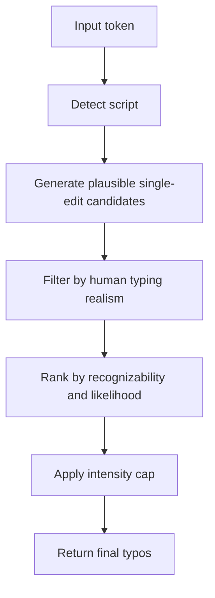

# Typo Generation Rules

## Goal

Generate typos that feel like real human mistakes, not random string mutations.

## Core Principles

1. Prefer single-edit mistakes.
2. Prefer mistakes caused by typing behavior, not linguistic drift.
3. Keep output recognizable to the original word.
4. Be conservative for mixed-script tokens.
5. Block valid-but-uncanny outputs.

## Human Typo Classes

### Keep

- Adjacent key misorder / transposition
  - Example: `Seoul -> Soeul`
- Same-line key mistype
  - Prefer horizontal neighbors over vertical or diagonal neighbors
- Repeated-letter omission
  - Example: `Coffee -> Cofee`
- Missed key / omission
- Korean 2-beolsik adjacent-key slips
- Korean missed final consonant / missed keystroke

### Secondary / Low Priority

- Double press / repeated key
- Limited Korean keystroke transposition

### Avoid by Default

- Broad vertical/diagonal Latin substitutions
  - Example: `Seoul -> Sekul`
- Random vowel drift
- Multi-edit noise
- Script-breaking outputs
- Forced Korean vowel drift to create more variants
- IME mode-switch gibberish

## Script-Specific Rules

### Latin

Preferred order:
1. repeated-letter omission
2. adjacent transposition
3. same-line key substitution
4. other low-confidence substitutions only if still realistic

Rules:
- Prefer shape-preserving outputs.
- Penalize first-character corruption.
- Penalize substitutions that reduce recognizability too much.
- Treat `Soeul` as better than `Sekul` for `Seoul`.

### Korean (2-beolsik)

Preferred order:
1. adjacent-key substitution at jamo level
2. missed final consonant / missed keystroke
3. limited transposition
4. limited double press

Rules:
- One composition mistake at a time.
- One changed syllable at a time.
- No broad medial-vowel drift unless strongly tied to real key behavior.
- Reject impossible or uncanny Hangul compositions.

### Mixed Korean + Latin

Rules:
- Mutate only one script segment per candidate.
- Prefer the most recognizable typo.
- Allow at most one Latin-side fallback typo in final mixed-token results.
- Do not force Korean-side typo generation.
- Block uncanny mixed-token vowel drift.

## Intensity Policy

### Low

- Only highest-confidence typo(s)
- Strictly conservative
- Prefer one-edit, highly recognizable outputs

### Medium

- Add breadth without noise
- Still mostly single-edit outputs
- Allow low-priority fallback only when it still looks human-made

## Ranking Policy

High:
- repeated-letter omission
- adjacent transposition
- Korean adjacent-key substitution
- Korean missed keystroke

Medium:
- same-line Latin substitution
- limited Korean transposition

Low:
- double press
- mixed-token Latin fallback substitutions

## Quality Filters

A candidate should usually satisfy all of these:

- small edit distance
- high recognizability
- script integrity preserved
- only one realistic error event
- no impossible composition
- no uncanny output already known to be bad

## Product Examples

### Good

- `Coffee -> Cofee`
- `Seoul -> Soeul`
- conservative `카카오톡` keyboard slip
- conservative `서울여행` keyboard slip

### Bad

- `Seoul -> Sekul`
- artificial Korean vowel drift created only to increase variety
- mixed-script outputs that look machine-generated

## Decision Rule

When unsure, ask:

**Could a person realistically make this mistake while typing in one flow?**

If the answer is not clearly yes, do not generate it.
